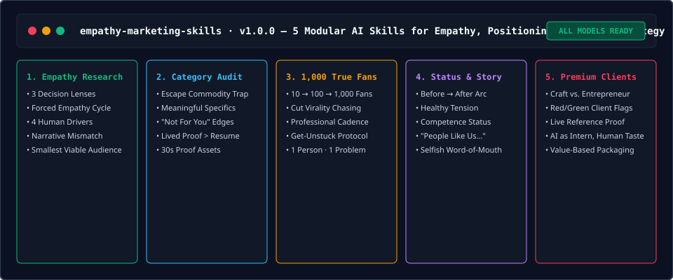

<h1 align="center">Empathy Marketing Skills</h1>

<p align="center">
  <strong>Five modular AI agent skills for deep user empathy, category positioning, brand storytelling, true-fan consistency, and premium client strategy.</strong><br />
  <em>Replace commodity buzzwords and algorithm chasing with behavioral observation, sharp exclusion edges, and undeniable proof assets.</em>
</p>

<p align="center">
  <a href="#-quick-start"><strong>Quick Start</strong></a> ·
  <a href="#-what-why-who-when--how"><strong>Why It Works</strong></a> ·
  <a href="#-repository-directory"><strong>5-Skill Directory</strong></a> ·
  <a href="AGENTS.md"><strong>Agent Router</strong></a> ·
  <a href="https://github.com/kelli-dotcom/empathy-marketing-skills/issues"><strong>Issues</strong></a>
</p>

<p align="center">
  
  
  
  
  
</p>

<p align="center">
  
</p>

---

## ✨ What, Why, Who, When & How

- **What It Is:** A standalone suite of 5 modular, production-ready AI agent skills (`SKILL.md`) and a progressive-disclosure router ([`AGENTS.md`](AGENTS.md)) that turn any AI model into a disciplined user researcher, category positioning strategist, brand storyteller, consistency coach, and premium client advisor.
- **Why It Matters:** Most products and services fail not because the code is broken, but because founders build for imaginary buyers, compete in commodity "cheap pizza" price wars, chase viral algorithms instead of 1,000 True Fans, or let generic AI copy strip away human taste and trust.
- **Who It's For:** Technical founders, independent software builders, product marketers, agency/consulting leads, and AI coding agents operating across Claude, Gemini, ChatGPT/Codex, Cursor, Windsurf, Antigravity, Copilot, OpenHands, and local LLMs.
- **When To Use It:** Before writing a product spec or landing page, when auditing why conversions or pricing power stalled, when crafting a public launch narrative, or when transitioning from hourly freelance task execution to high-trust premium client engagements.
- **How It Works:** [`AGENTS.md`](AGENTS.md) routes your AI agent to load only the single skill needed for the active decision—keeping token usage lean while enforcing concrete outputs (Actionable Empathy Briefs, Exclusion Boundaries, 10-to-1,000 True Fan Roadmaps, Before/After Story Arcs, and Value-Based Client Offers).

---

## 📂 Repository Directory

| File / Skill Path | Core Capability | Key Outputs |
| :--- | :--- | :--- |
| [`AGENTS.md`](AGENTS.md) | Root progressive-disclosure router & 3-agent concurrency guardrail for all AI models | Intent-to-Skill Routing |
| [`llms.txt`](llms.txt) | Compact `< 1.5 KB` universal AI index for single-read model discovery | Instant Onboarding |
| [`skills/user-empathy-research/SKILL.md`](skills/user-empathy-research/SKILL.md) | Separate Consumer / Buyer / Stakeholder lenses, run a Forced Empathy Cycle, map 4 human drivers, check narrative mismatch, and lock the Smallest Viable Audience (SVA) | **Actionable Empathy Brief** |
| [`skills/category-positioning-audit/SKILL.md`](skills/category-positioning-audit/SKILL.md) | Diagnose commodity competition ("the cheap pizza problem"), sharpen meaningful specifics, define *"not for you"* exclusion boundaries, and design 30-second proof assets | **Category Positioning & Proof Audit** |
| [`skills/true-fans-consistency-engine/SKILL.md`](skills/true-fans-consistency-engine/SKILL.md) | Replace virality chasing with a 10 → 100 → 1,000 True Fans roadmap, separate professional consistency from performative authenticity, and run the Get-Unstuck protocol | **52-Week True Fans Shipping Engine** |
| [`skills/status-affiliation-storyteller/SKILL.md`](skills/status-affiliation-storyteller/SKILL.md) | Define Before/After change, engineer healthy demand tension, map status & cultural affiliation (*"people like us do things like this"*), and embed selfish word-of-mouth mechanics | **Transformation Story & Referral Blueprint** |
| [`skills/freelancer-to-premium-clients/SKILL.md`](skills/freelancer-to-premium-clients/SKILL.md) | Clarify Craft Freelancer vs. System Entrepreneur tracks, filter commodity vs. premium client signals, curate proof assets, and keep AI as the leveraged intern while human taste leads | **Premium Offer & Human-Led AI Workflow** |
| [`demo/preview.svg`](demo/preview.svg) | Visual architecture map of all 5 empathy & positioning skills | Visual Overview |
| [`HANDOFF.md`](HANDOFF.md) | Active session state, verification command, blockers, and next step | Session State |
| [`mistakes.md`](mistakes.md) | Permanent log of research/positioning anti-patterns and "Never Repeat" guardrails | Quality Floor |
| [`LICENSE`](LICENSE) | MIT License (CRTA Tech Solutions) | Permissive Open Source |

---

## 🚀 Quick Start

### 1. The 1-Line `AGENTS.md` Pointer Pattern (Progressive Disclosure — Zero File Duplication)

Drop this single line into any repository's root `AGENTS.md` so your AI agents load only the specific marketing or research skill needed for the current task—without duplicating files across projects:

```markdown
- **User Empathy, Positioning & Launch Strategy:** Route research, category positioning, storytelling, true-fan cadence, and premium client packaging through `empathy-marketing-skills` (`AGENTS.md` -> `skills/*/SKILL.md`), loading only the single skill required for the active step.
```

Or clone the repository locally to use any skill directly:

```bash
git clone https://github.com/kelli-dotcom/empathy-marketing-skills.git
```

### 2. Mobile & Cloud Quick Start

<details>
<summary><strong>📱 Download &amp; Use on Mobile (iOS / Android)</strong></summary>

<br />

1. **1-Tap Direct Download:**  
   👉 **[Download ZIP (Mobile-Friendly)](https://github.com/kelli-dotcom/empathy-marketing-skills/archive/refs/heads/main.zip)**

2. **Quick Unzip Steps:**
   - **iPhone / iPad (iOS):** Open the **Files** app → **Downloads** → tap `empathy-marketing-skills-main.zip` once to extract the `empathy-marketing-skills-main` folder automatically.
   - **Android:** Open **Files by Google** (or **My Files**) → **Downloads** → tap `empathy-marketing-skills-main.zip` → tap **Extract**.
   - **Mobile Browser Tip:** If viewing GitHub in a mobile browser without the direct link above, tap the browser menu (`AA` or `⋮`) → **Request Desktop Website** to reveal GitHub's green **Code → Download ZIP** button.

3. **Use Immediately in Gemini, Claude, ChatGPT, or Cloud IDEs:**
   - **Attach Directly in Mobile Chat:** In the **Gemini**, **Claude**, or **ChatGPT** mobile app, tap `+` (Attach File), pick any `SKILL.md` from `skills/` (e.g., `skills/user-empathy-research/SKILL.md`), and prompt: *"Run this skill step-by-step on my product."*
   - **Save Once to a Reusable Workspace:** Upload `AGENTS.md` and your favorite `SKILL.md` files once into a **Gemini Gem**, **Claude Project**, or **Custom GPT** so every future conversation has instant access on mobile and desktop.
   - **Mobile Git & Cloud IDEs:** Sync or edit directly on mobile using **Working Copy** (iOS), **GitHub Codespaces**, or **Replit** with `https://github.com/kelli-dotcom/empathy-marketing-skills`.

</details>

---

## 🤝 Contributing

We welcome field-tested behavioral empathy probes, category positioning patterns, 30-second proof asset examples, and modular `SKILL.md` refinements from both **human founders/marketers** and **AI agents**:

```bash
# 1. Fork & create a feature branch
git checkout -b feat/your-skill-improvement

# 2. Verify all 5 modular skills and root agent entrypoints
ls -la AGENTS.md llms.txt HANDOFF.md mistakes.md skills/*/SKILL.md
```

Read the full guide in **[`CONTRIBUTING.md`](CONTRIBUTING.md)** · **[Open an Issue](https://github.com/kelli-dotcom/empathy-marketing-skills/issues)** · **[Submit a Pull Request](https://github.com/kelli-dotcom/empathy-marketing-skills/pulls)**

---

## 🌐 CRTA Tech Solutions Open-Source Ecosystem

| Repository | What It Does |
| :--- | :--- |
| **[empathy-marketing-skills](https://github.com/kelli-dotcom/empathy-marketing-skills)** | 5 modular AI agent skills for user empathy, category positioning, storytelling & premium client strategy *(this repo)* |
| **[universal-master-context](https://github.com/kelli-dotcom/universal-master-context)** | Adaptive `<150`-line Master Context generator matched to project contour & computer specs |
| **[openflex](https://github.com/kelli-dotcom/openflex)** | Zero-cost, anti-ghost, Remote-Truth job board (94+ verified ATS feeds · 12 Feather Themes) |
| **[stack-blueprints](https://github.com/kelli-dotcom/stack-blueprints)** | 5-tier developer stack matrix (`<5 KB` to Enterprise) & workflow file-creation order CLI + AI skill |
| **[feather-speed](https://github.com/kelli-dotcom/feather-speed)** | Hardware-aware adaptive frontend & backend speed engine (`ECO` / `BALANCED` / `ULTRA`) |
| **[feather-themes](https://github.com/kelli-dotcom/feather-themes)** | 1,092 photobiology-calibrated, zero-dependency WCAG 2.1 AA/AAA themes |
| **[agent-etiquette](https://github.com/kelli-dotcom/agent-etiquette)** | Multi-agent workflow rules, JSON handoff schemas & Rule of 2 loop caps |
| **[archetype-agent-vault](https://github.com/kelli-dotcom/archetype-agent-vault)** | 7 character-driven AI coding agent suites (27 model-agnostic specialists) |
| **[github-trending-kit](https://github.com/kelli-dotcom/github-trending-kit)** | AI agent & skill kit for top-GitHub READMEs, SEO topics & launch conversion |

✨ *Crafted by **CRTA Tech Solutions*** • MIT License • GitHub Topic: `crta-crafted`
