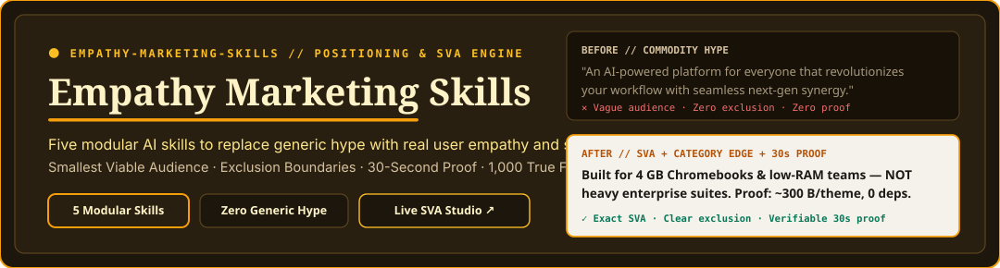

[](https://kelli-dotcom.github.io/empathy-marketing-skills/preview/)

# Empathy Marketing Skills

Come in. Everything here has its place, and nothing is missing.

Fourteen modular AI agent skills for deep user empathy, category positioning, brand storytelling, true-fan consistency, premium client strategy, funnels that turn free users into paid buyers, social systems online and in person, clear communication, and prices that are fair to the buyer and the owner.

**Inside**

- `skills/user-empathy-research/` — hear what users really mean
- `skills/category-positioning-audit/` — find the edge of the category
- `skills/status-affiliation-storyteller/` — stories people want to belong to
- `skills/true-fans-consistency-engine/` — keep 1,000 true fans close
- `skills/freelancer-to-premium-clients/` — from freelancer to premium
- `skills/funnel/` — turn free users into paid buyers
- `skills/cybersocial-engineer/` — build trust and community online
- `skills/human-social-engineer/` — build trust and relationships in person
- `skills/clear-communication/` — say it plainly, point first
- `skills/price-worth/` — a fair price, with the reasoning shown
- [Live SVA & Positioning Studio](https://kelli-dotcom.github.io/empathy-marketing-skills/preview/) (`preview/index.html`) — build and audit a before/after positioning brief live

**Use it**

```sh
node tests/smoke.test.mjs
```

Details: [docs/START_HERE.md](docs/START_HERE.md). MIT license — see [LICENSE](LICENSE).
